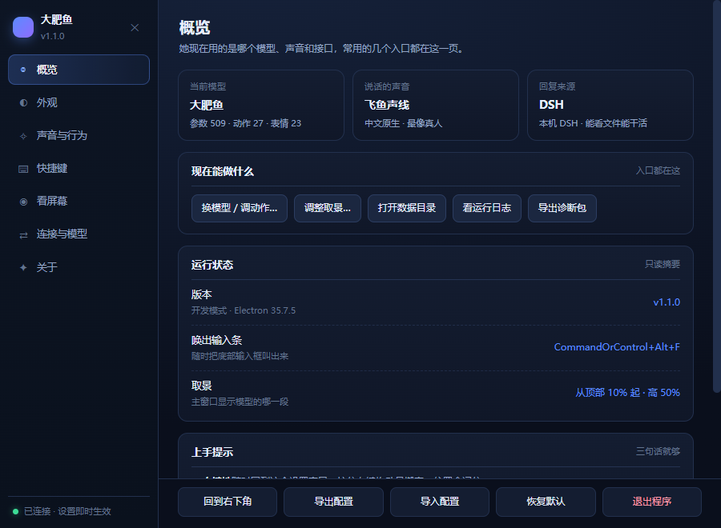
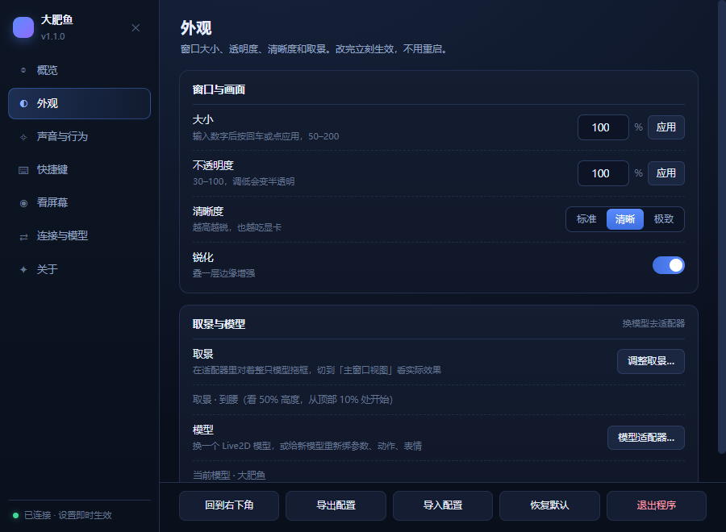
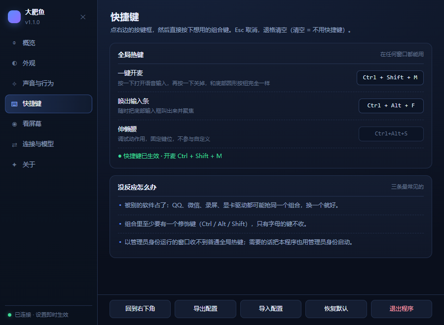
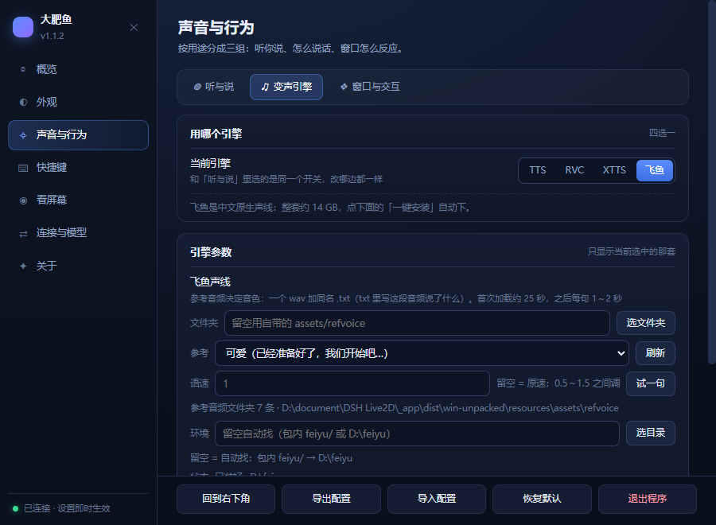
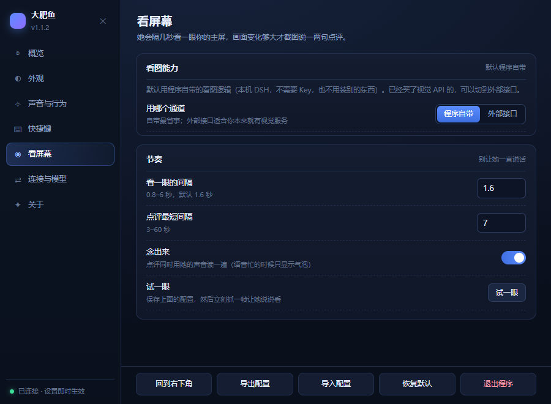
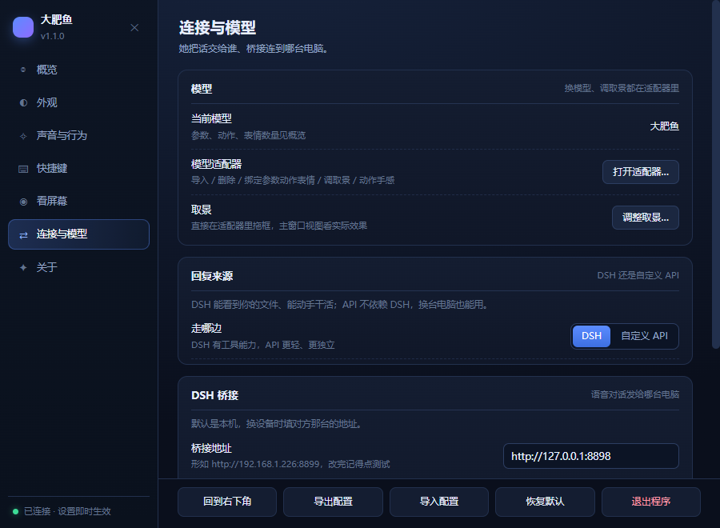
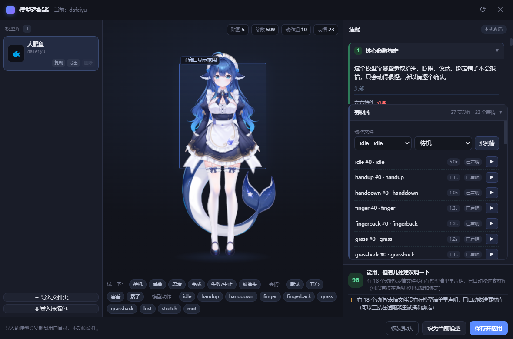
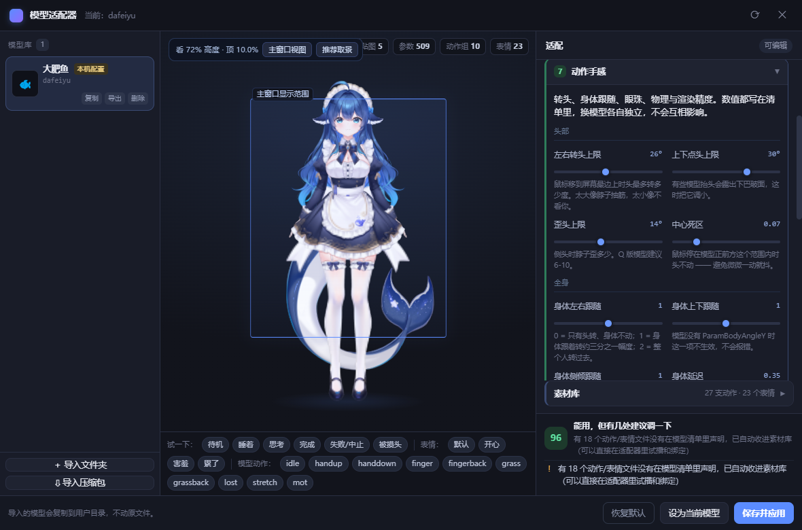
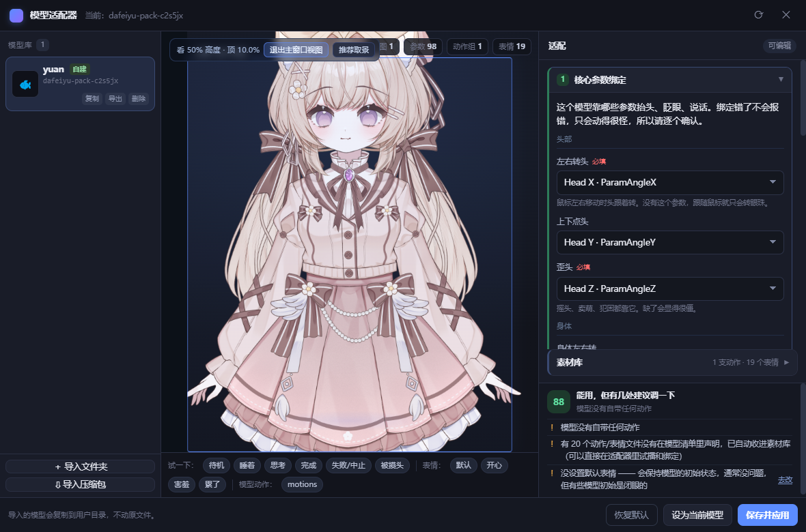
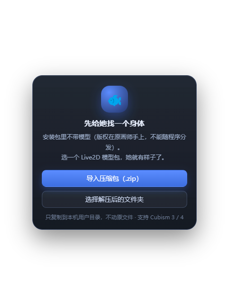

# 大肥鱼 · 桌面宠物

一只住在屏幕右下角的 Live2D 桌宠。独立 Windows 程序，不依赖任何编辑器或插件，装好就能用。

透明无边框窗口、逐像素鼠标穿透、真实物理与呼吸；能听你说话、用几种声线回你、会转头看你、会走神、会打哈欠；也能把任意 Live2D 模型接进来——参数、动作、表情、取景、手感全部可视化调，不用改一行 JSON。

> **安装包不含任何 Live2D 模型。** 模型版权在原画师手上，不随程序分发；第一次打开会引导你导入自己的模型（zip 或解压后的文件夹）。


---

## 目录

- [功能总览](#功能总览)
- [界面巡览](#界面巡览)
- [模型系统：把模型从代码里搬出去](#模型系统把模型从代码里搬出去)
- [语音链路](#语音链路)
- [对话与看屏幕](#对话与看屏幕)
- [交互细节](#交互细节)
- [安装](#安装)
- [从源码构建](#从源码构建)
- [目录结构](#目录结构)
- [隐私](#隐私)
- [已知限制](#已知限制)
- [许可与致谢](#许可与致谢)

---

## 功能总览

| 分类 | 能力 |
|---|---|
| 渲染 | Live2D Cubism 3 / 4；贴图按需缩到 2048 再上 GPU（8192 原图也不爆显存）；透明窗口 + 逐像素穿透；DPI 自适应（≤2×）；空闲自动降帧降分辨率；锐化开关 |
| 模型 | 任意模型接入：12 个参数语义槽 / 27 个场景动作槽 / 7 个表情槽；zip 直投、文件夹导入、拖拽导入；未声明动作与表情自动收录；素材库逐条试播（动作 + 未声明表情都能放）；动作文件引擎；16 项手感；取景框（拖拽 / 滚轮 / 主窗口视图 / 推荐取景） |
| 语音 | 麦克风 VAD 自动断句；ASR（whisper.cpp / 系统语音）；四套输出引擎任选：飞鱼 TTS、XTTS-v2、RVC 变声（ONNX + DirectML，N/A 卡与核显都能跑）、Edge TTS 兜底；逐段流式播放、可打断；引擎空闲 10 分钟自动卸载，进程也跟着退 |
| 对话 | DSH 桥接（本机或局域网）或任意 OpenAI 兼容 API；气泡多行自适应；失败不静默 |
| 看屏幕 | 默认走程序自带的看图逻辑（不需要 Key）；也可切成外部视觉接口。每隔几秒截一张主屏，画面变化大才点评；可念出来 |
| 交互 | 拖动、单击三档（头 / 脸 / 身体）、连点四层、90 秒走神、两分钟长待机、深夜打哈欠、鼠标注视（以她为中心算角度）、DSH 干活时进入思考状态 |
| 设置 | 七页签设置中心（900×660 可拉伸）；改完立即生效；配置导出 / 导入；诊断包；崩溃记录 |
| 发行 | NSIS 安装包（约 900 MB，含离线语音与变声环境）；静默安装；卸载清理；单实例；开机自启（回读注册表验证）；托盘；冷启动常驻内存约 580 MB |

---

## 界面巡览

### 设置中心 · 概览

左边七个页签，右边按用途分组。当前模型、声线、回复来源、版本与热键一屏看完；换模型、调取景、打开数据目录、看日志、导诊断包五个入口都在这里。



### 设置中心 · 外观

大小、不透明度、清晰度、锐化；取景一行只读显示当前范围（到腰 / 头到胸…），要改就去适配器的取景步骤——取景只有那一个入口，不再有第二个地方各存一份。



### 设置中心 · 快捷键

全局热键可以点框直接按组合键录制；下面一张「没反应怎么办」把三种最常见的原因写清楚（被别的软件占用、缺修饰键、管理员窗口收不到）。



### 设置中心 · 变声引擎

四套引擎（TTS / RVC / XTTS / 飞鱼）在页首直接选，下面只显示当前这套的参数；选 TTS 时给一句「不需要装任何东西」的说明，不会让人以为功能被砍掉了。



### 设置中心 · 看屏幕

默认就是程序自带的看图逻辑，不需要填 Key、也不依赖外部服务；只有你本来就有视觉 API 时才切到「外部接口」，三行配置收在折叠区里。



### 设置中心 · 连接与模型

DSH 桥接地址、连通性测试、本机自带桥接；回复来源可切「DSH」或「自定义 API」。模型卡显示当前模型，换模型与调取景都跳适配器。



### 模型适配器

三栏：左边模型库，中间实时预览（可试播动作、试表情、拖取景框），右边按步骤绑定参数 / 动作 / 表情 / 取景 / 手感 / 能力开关。右上角是体检分数和逐条建议。



### 素材库与手感

右栏底部的素材库列出模型里全部动作（组 / 序号 / 时长 / 是否声明）和表情，逐条试播；顶部绑定栏能把任意一支动作绑到 27 个语义槽之一。



### 导入任意模型

zip 直接拖进窗口，或点「导入压缩包」；解包、剥壳、找 `model3.json`、扫未声明素材、生成清单一次完成。下面这张是另一套模型（只有 1 张贴图、98 个参数、19 个表情，动作全部没在清单里声明）导入后的样子——素材照样全收进库。



### 没有模型的第一分钟

安装包不带模型。第一次打开不是报错页，而是一张导入卡：选 zip，或选解压后的文件夹；窗口自动收成 356×512，不会用一块透明大窗挡住桌面。导入成功后自动长回正常尺寸。



---

## 模型系统：把模型从代码里搬出去

### 语义槽：程序只认「意思」，不认参数名

模型的参数名千奇百怪（`ParamAngleX`、`Param14`、`ParamEyeBallX`…），程序不该认识它们。适配器把「程序需要什么」固定成三张表：

- **12 个参数槽**：左右转头、上下点头、歪头、身体左右、身体前后、眼珠 X/Y、左右眼开合、 mouth open / form、呼吸
- **27 个场景动作槽**：待机、睡着、思考、完成、失败/中止、被摸头、害羞、累了、伸懒腰……
- **7 个表情槽**：默认、开心、害羞、累、好奇、难过、生气

每个槽可以填多个候选参数名（别名），运行时按顺序找第一个存在的。换模型只需要在适配器里把下拉选一遍——选错了也不会崩，只会「动得很怪」，体检会指出来。

### 导入：zip / 文件夹 / 拖拽

- **zip 直投**：自己实现的解包器（`src/packs/zip.js`），支持存储与 deflate、GBK 中文文件名、路径穿越防护、压缩炸弹防护，不依赖 7-Zip。
- **自动剥壳**：zip 里如果只有一层同名目录，自动剥掉；`model3.json` 可能在根目录，也可能在一层子目录里。
- **未声明素材扫描**：大量模型的 `model3.json` 只写 Moc / Textures / Physics，`motions/`、`expressions/` 里的文件一个都没声明。导入时递归扫包内目录，把没声明的动作与表情一并收进素材库，标「未声明」，体检里写明数量。
- **复制而不移动**：整目录复制到 `%APPDATA%\dafeiyu-desk\models\<id>`，不动源文件夹；psd / cmo3 / blend 与 previews 缓存自动跳过。

### 动作文件引擎

场景动作的来源有三种：内置曲线（82 支跨模型动作）、模型自带动作（组 + 序号）、指定动作文件（`file:包内相对路径`）。指定文件由 `src/motion3.js` 解析——Linear / Bezier / Stepped / InverseStepped，只取 Target 为 Parameter 的曲线。文件名怎么改都不影响绑定。

### 手感（16 项，逐模型独立）

| 组 | 项 |
|---|---|
| 头部 | 左右转头上限、上下点头上限、歪头上限、中心死区 |
| 全身 | 身体 X / Y / Z 跟随增益、身体滞后 |
| 眼睛 | 眼珠跟随增益、眼珠最大偏移 |
| 物理与渲染 | 物理步长（16 / 33 / 50 ms / 关）、裁剪遮罩精度（256 / 512 / 1024 / 2048）、过渡时长倍率 |
| 动作 | 播放速度、参数锁、待机也锁 |

默认值按实际手感反推（26° / 30° / 14° / 0.07）。物理单帧步长封顶 1/30 秒，掉帧不会过冲；遮罩精度在模型加载后首帧前设置一次，避免运行中切换导致崩溃。

**参数锁**：播放模型动作或动作文件时，这支动作驱动的参数会被锁住，追踪层不再每帧覆盖；锁有 TTL 兜底，待机动作默认不锁（待机要和鼠标注视共存）。

### 取景：模型的一部分

取景框在适配器中间：拖框上下移动、拖边改高度、滚轮以指针为中心缩放，右边滑杆实时同步。点「主窗口视图」按主窗口宽高比切一个竖口、两侧压暗，看到的就是桌面上露出来的那一段；「推荐取景」按模型参数自动给一版（有腿/膝/足参数 → 全身，否则半身）。结果存进模型包的 `pet.json`，换模型各自独立。

---

## 语音链路

```
麦克风 → VAD 自动断句（动态底噪 + 阈值封顶）
      → ASR：whisper.cpp（本地） / 系统语音
      → 发送到 DSH 当前会话，或自定义 API
      → 回复 → TTS：飞鱼 / XTTS-v2 / RVC 变声 / Edge
      → 气泡 + 分段播放（可打断）
```

- **飞鱼 TTS**：中文原生，流式首句优先，默认引擎。
- **XTTS-v2**：参考音色克隆，本地推理。
- **RVC 变声**：ONNX + DirectML，不依赖 CUDA Toolkit；启动时自动扫描 `rvc/models/` 里的 `.pth` 并在后台转 ONNX，转换期间服务不中断。
- **兜底链**：RVC → 本地 TTS → DSH TTS，任一段失败自动降级，失败信息会显示在气泡里，不静默。

语音识别模型（whisper turbo，约 1.6 GB）不随安装包分发，第一次用到时询问后再下载，支持暂停 / 续传 / 断点。

---

## 对话与看屏幕

- **DSH 桥接**：默认连本机 `127.0.0.1:8898`，也可以填局域网地址；「本机自带桥接」可一键起停。连不上会明确说连不上，不会假装在思考。
- **自定义 API**：任意 OpenAI 兼容接口（Base URL / Key / Model）。Key 只存本机，不写进导出的配置文件。
- **看屏幕**：每隔 0.8–6 秒截一张主屏（只在本机处理），画面变化足够大才点评；视觉接口留空走本机 DSH，填了才把截图发给外部视觉服务。点评最短间隔可调，可只显示气泡不发声。

---

## 交互细节

| 动作 | 结果 |
|---|---|
| 按住拖动 | 移动窗口（跨屏也准，位移在主进程算） |
| 单击 | 摸她，按位置分三档（头 / 脸 / 身体），台词不同 |
| 连点 | 力度递增，最多四层 |
| 右键 | 打开设置 |
| 鼠标移动 | 头和眼睛跟着你，以她双眼中心为枢轴算角度 |
| 停手 90 秒 | 走神，看向一边 |
| 两分钟没动静 | 长待机动作 |
| 深夜 23–5 点 | 有概率打哈欠 |
| DSH 在干活 | 进入思考状态（扫 session 文件写入时间） |

缓动按通道分层：眨眼 0.035 s、眼珠 0.09 s、头部 0.22 s（点头 0.07 s）、身体 0.55 s——眼睛永远比头快半拍，这是「像活的」和「像机器人」的分界线。

---

## 安装

### 下载

| 文件 | 大小 | SHA-256 |
|---|---|---|
| [dafeiyu-1.1.2-setup.exe](https://github.com/hanhan9999999999999999999/dafeiyu-desk/releases/download/v1.1.2/dafeiyu-1.1.2-setup.exe) | 940,094,007 B（≈ 896.5 MB） | `27738b161255e05f8eb80875b40bfe46cd700ec68cb93a4e256d11ce0c1da9e9` |

页面版入口：[Releases · v1.1.2](https://github.com/hanhan9999999999999999999/dafeiyu-desk/releases/tag/v1.1.2)。

1. 下载上面的 `dafeiyu-1.1.2-setup.exe`（约 900 MB，含离线语音与变声环境）。
2. 双击安装。程序未做代码签名，SmartScreen 会提示「未知发布者」——这是当前版本的已知限制，不是文件损坏。
3. 第一次打开会引导导入模型：选一个 `.zip`，或选解压后的模型文件夹。
4. 右键她和托盘图标都能进设置。

校验下载是否完整（PowerShell）：

```powershell
Get-FileHash .\dafeiyu-1.1.2-setup.exe -Algorithm SHA256
# 应输出 27738B16...DA9E9
```

静默安装：

```
dafeiyu-1.1.2-setup.exe /S /D=D:\Apps\Dafeiyu
```

> 升级安装会保留 `%APPDATA%\dafeiyu-desk` 里的设置与已导入的模型。

---

## 从源码构建

需要 Windows 10/11、Node.js 20+、一个 Electron 35 运行时目录（`_app/runtime/`）。详细步骤见 [BUILD.md](BUILD.md)。

```bash
cd _app
npm install
npm run verify          # 源码自检 + 规则自检 + 产物自检
npm run build           # electron-builder --win --x64
```

自检脚本会检查：每个页面都有 CSP、页面引用的脚本真的存在、`preload` 暴露的每个 IPC 通道在主进程都有 handler、每个 `getElementById` 的 id 在对应 HTML 里存在，以及打包产物里「该有的文件都有、不该有的模型文件一个都没有」。

---

## 目录结构

```
_app/
├── src/
│   ├── main.js              主进程：窗口、托盘、IPC、桥接、热键
│   ├── renderer.js          Live2D 渲染、参数追踪、手写动作
│   ├── motion3.js           motion3.json 解析（Linear/Bezier/Stepped）
│   ├── adapter.html/js      模型适配器（三栏 + 素材库 + 取景）
│   ├── settings.html/js     设置中心（七页签）
│   ├── packs/               语义槽、清单、探测、存储、规则插件
│   ├── voice.js             麦克风、VAD、ASR/TTS/RVC 客户端
│   ├── pet.js / lines.js    交互状态机、台词池
│   └── server.js            本地静态服务 + 引擎路由
├── engine/                  ASR / TTS / XTTS / 飞鱼 引擎（Node + Python）
├── bridge/                  本机 DSH 桥接
├── vendor/                  Live2D 渲染引擎（Cubism Core 需自行取得）
├── assets/                  图标、许可、隐私说明
└── scripts/                 verify-src / verify-packs / verify-pack
```

---

## 隐私

- 对话、截图、语音默认全部在本机处理；只有你显式配置了外部 API / 视觉接口时，相应内容才会发到那个地址。
- API Key 只存本机 `settings.json`，**永远不进导出的配置文件**，也不进诊断包（诊断包导出前会把密钥类字段替换成 `<已隐藏>`）。
- 没有遥测、没有统计上报、没有自动上传。
- 完整说明见 [`assets/PRIVACY.txt`](assets/PRIVACY.txt)。

---

## 已知限制

- **仅 Windows**：置顶、鼠标穿透、开机自启用的是 Windows API，换平台要重写窗口层。
- **无代码签名**：SmartScreen 会提示未知发布者；正式商业发行需要 OV/EV 证书。
- **无自动更新**：当前靠覆盖安装升级；自动更新需要签名与更新服务器。
- **安装包约 900 MB**：含 Electron、ffmpeg full build、RVC 运行环境与 ONNX 模型；whisper turbo（1.6 GB）按需下载。
- **常驻开销**：60 fps 时约占单核 70%（渲染 + GPU），空闲自动降到 30 fps / 1× 分辨率；工作集约 585–640 MB，长时间实测无泄漏特征。
- **托盘图标不随 DPI 缩放**，高 DPI 下略糊。

---

## 许可与致谢

**程序本体**：自研代码，保留所有权利。可查看、学习与本地构建；未经许可不得重新分发编译产物或用于商业发行。

**Live2D**：渲染使用 Live2D Cubism SDK。`live2dcubismcore.min.js` 属于 Live2D 专有许可，**不随本仓库分发**，构建前请自行从 [Live2D 官网](https://www.live2d.com/sdk/download/web/) 取得并放入 `vendor/`。使用本程序需遵守 [Live2D 软件使用许可](https://www.live2d.com/eula/live2d-proprietary-software-license-agreement_cn.html)。

**模型**：仓库与安装包都**不包含任何模型文件**。截图中的「大肥鱼」模型由 **神宫凉子**（原画 / 拆分）与 **霓虹猫_NeonNeko**（Live2D 建模）制作，仅用于展示，禁止重新分发完整模型文件。用户自行导入的模型，其授权由该模型作者决定。

**第三方**：PixiJS（MIT）、pixi-live2d-display（MIT）、Electron（MIT）、ffmpeg（LGPL/GPL，按构建配置）、ONNX Runtime（MIT）、whisper.cpp（MIT）。各自许可见其仓库。
