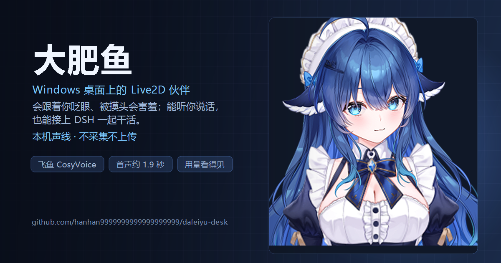
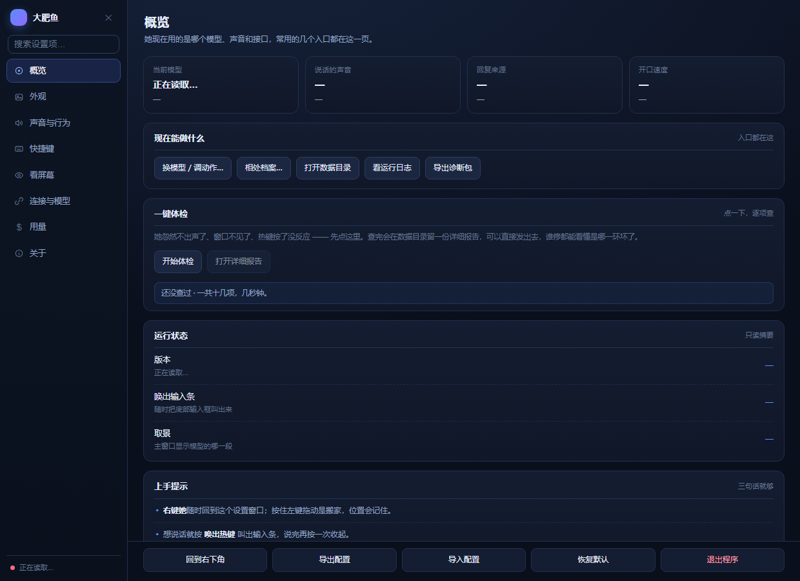
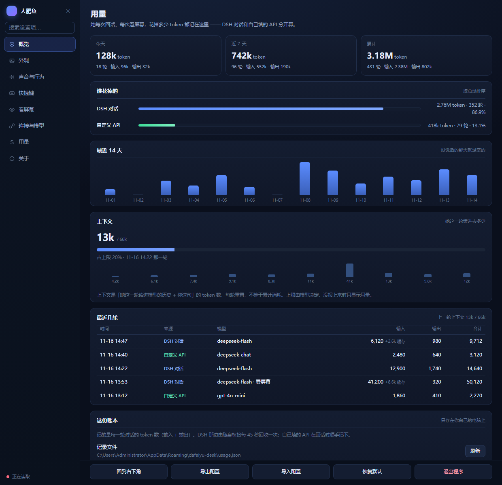
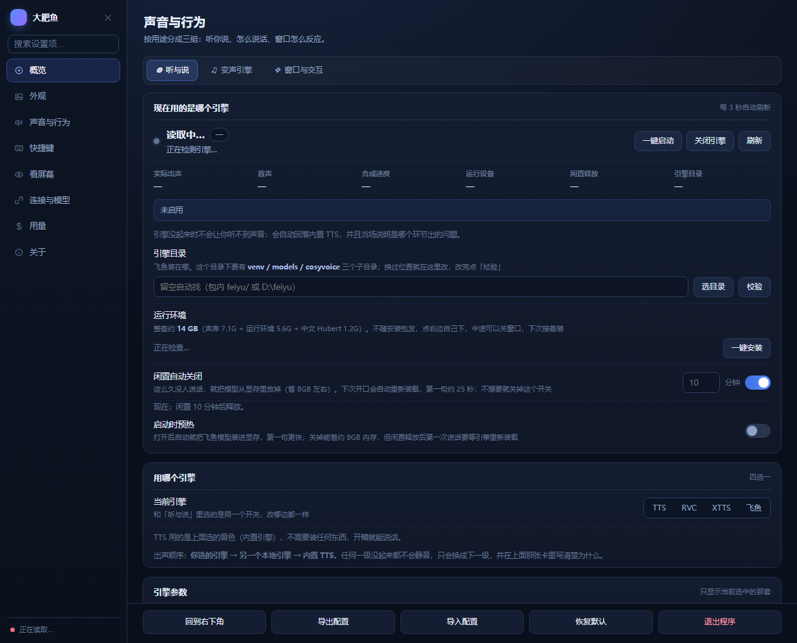

# 大肥鱼 · 桌面 Live2D 伙伴



<p>
  
  
  
</p>

Windows 桌面上的 Live2D 挂件：她跟着鼠标看、被摸头会害羞，能听你说话、看你的屏幕，
也能直接和你正在用的 DSH 会话对话。安装包里的进程名是 `dafeiyu-desk`。

**[下载安装包](https://github.com/hanhan9999999999999999999/dafeiyu-desk/releases/latest)** ·
[更新日志](CHANGELOG.md) · [项目总览](PROJECT.md) · [验收清单](验收清单.md) · [1.6.5 发版说明](docs/RELEASE-1.6.5.md)

---

## 她能做什么

|  |  |
|---|---|
| **看在眼里** | 睁开眼就有她在：视线跟着鼠标走、眨眼、呼吸、发呆、换姿势，摸头/摸脸/摸身体各有反应，双击和长按还有别的。 |
| **听得懂** | 麦克风常听、VAD 自动断句，叫她的名字能唤醒；说完自动收，不用按键。 |
| **说得出声** | 四条路可挑：本机飞鱼 CosyVoice 声线（最像真人）、XTTS 克隆、RVC 变声、Edge 内置 TTS。首声约 1.9 秒，句间不留空档。 |
| **看得见屏幕** | 需要时她能看你的屏幕再回答（独立会话，用量单独记账）。 |
| **接得上 DSH** | 和 DSH 的会话连起来，她替你说、替你听；DSH 没装也能用自带桥接直连本机。 |
| **算得清账** | 设置里「用量」一页：今天/近 7 天/累计、按来源分开、上下文占用走势。**只存本机。** |


## 长什么样

左边是她，右上角是气泡，底部是输入条。她说话时输入条右侧的「发送」会变成红色「停止」，
点一下就能让她闭嘴（说话过程中 Enter 也是这个键）。

设置窗口按用途分成八页：概览、外观、声音与行为、快捷键、看屏幕、连接与模型、用量、关于。
每页都有一句「这一页干什么」的说明，搜一下 `Ctrl/⌘+F` 就能过滤到具体的某一行。

<br clear="right">

### 概览：一眼看到她现在是什么状态



四张小卡分别是当前模型、说话的声音、回复来源、开口速度（首声实测 + 合成速度）。
下面是一键体检、运行状态和上手提示 —— 出问题的时候点「开始体检」，十几项逐项检查，报告可以直接发出来。

### 用量：她花了多少 token



今天 / 近 7 天 / 累计三张卡，按「DSH 对话」和「自定义 API」分开算占比；
最近 14 天柱状图，最近 24 轮明细（时间、来源、模型、输入、输出、合计）。
输入列里的 `+2.6k 缓存` 是「合计减去输入输出」的差额 —— 那是缓存命中的上下文，
不标出来会以为账算错了。

### 声音与行为 · 变声引擎



现在用的是哪个引擎、首声多少秒、合成速度是实时的几倍、跑在什么设备上、闲置多久释放显存，
都写在这张卡上。自己用命令行起的引擎也会如实显示（标注「这个进程不是本程序启动的」），
「一键启动」会真的把模型装进显存。

---

## 下载与安装

安装包在 [Releases](https://github.com/hanhan9999999999999999999/dafeiyu-desk/releases/latest)：

- 文件名 `大肥鱼-1.6.5-安装包.exe`（自动更新走同名硬链接 `dafeiyu-desk-setup-1.6.5.exe`），
  约 **887.5 MB**（语音模型和运行环境都在里面，装完不用再下东西）。
- 校验：`Get-FileHash .\大肥鱼-1.6.5-安装包.exe -Algorithm SHA256`
  → `E7C1771B11EE3583C4FE1B94F6E29372E7DA74597DD3FFE6420F67B2F671D597`
- 1.6.6 只改了代码（看屏幕的用量收敛），没有重新打包：安装包还是上面这个 1.6.5，想看屏幕的修复要等下一次打包的版本。
- **不捆绑模型**：Cubism 模型按版权单独分发。程序自带一只「大肥鱼」，换成你自己的模型走设置里的
  [模型适配器](docs/模型适配器-使用说明.md)（导入 zip，取景、动作、表情、点击分区都在里面调）。
- 绿色使用：安装器是 NSIS，卸载会清干净；配置和聊天记录都在用户数据目录，
  设置里「关于」页能直接打开、导出配置、恢复默认。

## 语音是怎么跑起来的

这套程序对「开口慢」这件事比较较真，链路上每一段都量过：

```
麦克风 → VAD 断句 → 桥接/API 拿回复 → 句子切分 → 本机 CosyVoice 流式合成 → 一根 WebAudio 时间轴
```

- **切分**：先等整句、再按标点切；第一句会在第一个逗号处先开一小口（实字 ≥9 才算），后面的句子更长、更省固定开销。
- **流式合成**：CosyVoice 每 25 个 token 吐一块（约 1 秒音频），首块到齐就开播，不等整段。
- **播放**：所有块排进同一根时间轴，采样级首尾相接；引擎来不及的缺口由播放器的余粮吃掉。
- **省下来的四处白等**（参考音目录扫描、说话人特征、`token_hop_len` 复位、预热推理）写在
  [1.3.2 发版说明](docs/RELEASE-1.3.2.md) 和 [语音提速记录](docs/VOICE-1.6.0.md) 里。

## 数据与隐私

- 语音识别、语音合成都在本机跑；不把音频上传到任何服务器。
- 用量账本、聊天记录、截图都只在本机的用户数据目录：
  `%APPDATA%\dafeiyu-desk\`（账本是 `usage.json`）。
- 用「自定义 API」时，只有你输入的文字/图片会发给那个 API；用 DSH 时走你自己的 DSH。
- `npm run audit:privacy`（含在 `verify` 里）会把「哪些文件会落盘、哪些能一键清掉」逐项对账。

## 从源码跑

需要 Windows 10/11 x64 与 Node 22+：

```powershell
cd _app
npm install
npm start            # 起主程序（electron .）
npm run verify       # 24 段自检：静态断言 + 各模块行为测试
```

常用脚本：

| 命令 | 作用 |
|---|---|
| `npm start` | 起程序 |
| `npm run verify` | 全量自检（提交前跑这个） |
| `npm test` | 只跑行为测试 |
| `npm run perf` | 语音/桥接性能基准 |
| `npm run build` | 打 Windows 安装包（electron-builder） |
| `npm run release:bundle` | 把安装包、`latest.yml`、发版说明归到 `dist/release-<版本>/` 并逐项校验 |

## 目录

```
_app/
  src/          主进程、渲染层、设置页（无框架，原生 JS）
    voice.js         语音链：切分、流式合成、时间轴播放、降级
    dock.js          底部输入条（含「停止」）
    usage.js         用量账本（去重、120 天/600 轮裁剪、原子写）
    settings*.{html,js}  设置八页
  engine/       飞鱼 CosyVoice 服务与客户端（feiyu_server.py / feiyu.mjs / tts.mjs）
  bridge/       与 DSH 的桥接（mini-bridge.mjs / runner-sdk.mjs）
  scripts/      自检脚本（verify-src、audit-*、test-*）
docs/           发版说明、模型适配器文档、截图
```

## 许可

程序代码见 [LICENSE.txt](_app/LICENSE.txt)，隐私说明见 [PRIVACY.txt](_app/assets/PRIVACY.txt)。
Live2D Cubism 模型与其贴图版权归原作者，本仓库不附带第三方模型。
