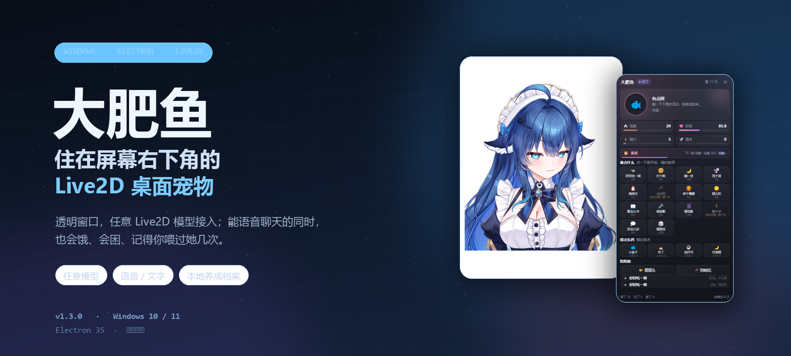
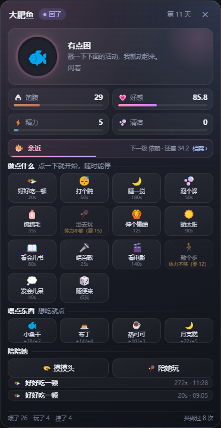
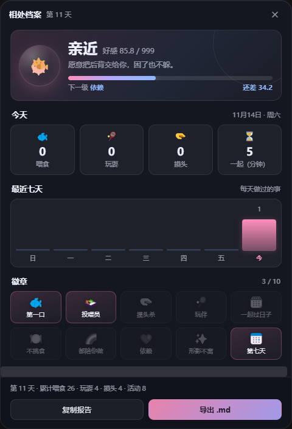
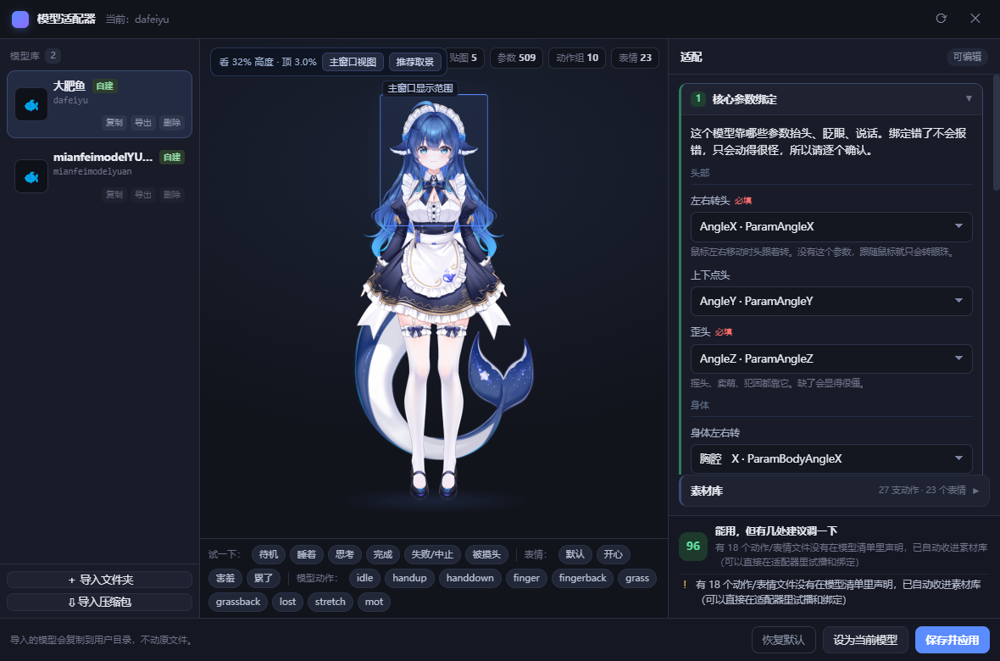
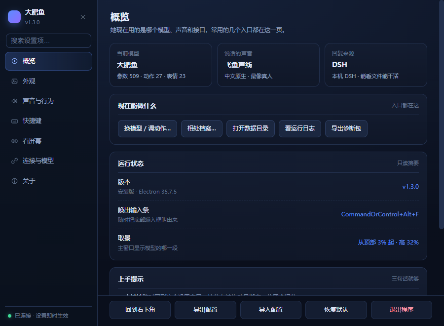

<p align="center">
  
</p>

<p align="center">
  
  
  
  
  
</p>

**大肥鱼**是一只住在 Windows 桌面右下角的 Live2D 鲸鱼娘。透明、无边框、始终置顶；能聊天、会饿、会困，也会记住你喂过她几次。

她不是网页里的一张立绘，也不是只能回复固定句子的桌宠。你可以给她换任意 Live2D 模型，接上自己的对话服务，或者在什么都不接的时候，留她在桌角发呆。

---

## 她能做什么

- **透明桌宠**：无边框透明窗口，始终置顶，可拖动、跟随鼠标、自动眨眼、呼吸和随机小动作；支持鼠标穿透和开机自启。
- **对话与语音**：文字输入、麦克风、TTS 朗读一条链路；可接本机 DSH 桥接，也可只把她当桌宠。
- **养成与关系**：饱腹、精力、清洁、好感四项状态；喂食、摸摸头、陪玩、看书、看电影……8 级关系、10 枚徽章，会饿也会闹脾气。
- **任意 Live2D 模型**：内置模型适配器，导入文件夹或压缩包，自动扫描未声明的动作/表情，手动绑定头部、身体、眨眼、说话参数。
- **相处档案**：今天做了什么、最近七天、关系等级、徽章墙，一键复制或导出 Markdown 报告。
- **本地优先**：养成存档在本地，配置可导出/导入；不需要注册账号，也不把聊天记录上传到第三方。

## 界面一览

<table>
  <tr>
    <td width="50%" valign="top">
      
      <br>
      <sub><b>状态面板</b> · 喂食、摸摸头、陪玩；饿的时候她会自己说</sub>
    </td>
    <td width="50%" valign="top">
      
      <br>
      <sub><b>相处档案</b> · 8 级关系、徽章墙、最近七天的记录</sub>
    </td>
  </tr>
  <tr>
    <td width="50%" valign="top">
      
      <br>
      <sub><b>模型适配器</b> · 导入任意 <code>.model3.json</code> 模型，绑定参数与素材</sub>
    </td>
    <td width="50%" valign="top">
      
      <br>
      <sub><b>设置</b> · 模型、声音、窗口行为、快捷键与桥接集中管理</sub>
    </td>
  </tr>
</table>

## 快速开始

### 1. 安装

到 [Releases](https://github.com/hanhan9999999999999999999/dafeiyu-desk/releases/latest) 下载 `大肥鱼-1.3.0-安装包.exe`，双击安装。

> 同一目录下的 `dafeiyu-desk-setup-1.3.0.exe` 是自动更新用的 ASCII 别名，与中文名安装包是同一个文件（硬链接），下哪个都一样。

> 安装包约 **900 MB**，包含 Electron 运行时和语音依赖，但**不包含任何 Live2D 模型**。模型是第三方作品，需要自己导入。

### 2. 导入模型

右键桌宠 → **模型适配器** → **导入文件夹** 或 **导入压缩包**，选择包含 `.model3.json` 的目录；确认参数绑定后点 **保存并应用**。

模型适配器会：

- 自动扫描包内没有写进 `model3.json` 的 `motions/`、`expressions/` 素材；
- 检查贴图、物理、参数是否齐全，给出一份可读的体检结果；
- 允许你手动指定头部、身体、眨眼、说话对应的参数，避免“能动但动得很怪”。

### 3. 接上对话（可选）

默认桥接地址是 `http://127.0.0.1:8899`。仓库自带一个只做健康检查、发消息、取状态的迷你桥接：

```bash
node bridge/mini-bridge.mjs --port 8899
```

它会在本机寻找 DSH 的 `bin.js` 和 `node.exe`，起一个常驻 DSH 子进程。没有装 DSH 也不影响桌宠本身：喂食、摸摸头、换模型、看档案都可以离线使用。

## 模型与声音

- 支持 Live2D Cubism 的 `.model3.json` 模型包，导入文件夹或 zip 均可。
- 程序与模型分离发行：**安装包里没有任何模型文件**（`.moc3`、贴图、动作、表情都不含）。仓库只保留驱动开发用模型所需的配置 JSON（参数、物理、表情定义），不含 `.moc3` 与贴图。
- 声音默认走 Edge TTS；也可以在设置里换成自己的 TTS / RVC / XTTS 引擎。没有配置语音时，文字对话仍然可用。
- Live2D Cubism Core 属于 Live2D 的专有组件，已随程序放在 `vendor/live2dcubismcore.min.js`，按 Live2D 的条款随应用一并提供；条款见 [LICENSE.txt](LICENSE.txt) 第三节。从源码构建不需要额外下载。

### CosyVoice / 飞鱼声线

飞鱼声线由 CosyVoice3 驱动。程序里的「一键安装」会优先走 `ghproxy.net` 和 `hf-mirror.com`；如果哪天代理或镜像不可用，可以按下面的原址自行下载，不必等程序更新。

| 组件 | 原址 | 镜像 / 固定版本 |
| --- | --- | --- |
| CosyVoice 源码 | [FunAudioLLM/CosyVoice](https://github.com/FunAudioLLM/CosyVoice) | 固定 commit [`074ca6d`](https://github.com/FunAudioLLM/CosyVoice/tree/074ca6dc9e80a2f424f1f74b48bdd7d3fea531cc) |
| 飞鱼声库 | [Esmerubphire/FeiyuVoice-CosyVoice3](https://huggingface.co/Esmerubphire/FeiyuVoice-CosyVoice3) | [hf-mirror 镜像](https://hf-mirror.com/Esmerubphire/FeiyuVoice-CosyVoice3) |
| 中文 Hubert | [TencentGameMate/chinese-hubert-base](https://huggingface.co/TencentGameMate/chinese-hubert-base) | [hf-mirror 镜像](https://hf-mirror.com/TencentGameMate/chinese-hubert-base) |
| Matcha-TTS（依赖） | [shivammehta25/Matcha-TTS](https://github.com/shivammehta25/Matcha-TTS) | 固定 commit [`dd9105b`](https://github.com/shivammehta25/Matcha-TTS/tree/dd9105b34bf2be2230f4aa1e4769fb586a3c824e) |

> 本机直连 `huggingface.co` 可能超时；表里的 `hf-mirror.com` 与 HF 仓库内容一致，优先用镜像。

手动放置时，目录结构：

```text
<飞鱼目录>\
├─ venv\                          # Python 3.11 环境
├─ cosyvoice\                     # CosyVoice 源码，切到 074ca6d
├─ models\
│  └─ FeiyuVoice-CosyVoice3\      # 飞鱼声库
└─ zh-hubert\                     # 中文 Hubert
```

源码可以直接 clone 到目标目录并切到验证过的版本：

```bash
git clone https://github.com/FunAudioLLM/CosyVoice.git "<飞鱼目录>\cosyvoice"
git -C "<飞鱼目录>\cosyvoice" checkout 074ca6dc9e80a2f424f1f74b48bdd7d3fea531cc
git -C "<飞鱼目录>\cosyvoice" submodule update --init --recursive
```

然后在 **设置 → 声音与行为 →「环境」** 里填 `<飞鱼目录>`。CosyVoice 需要 Python 3.11、PyTorch 2.11.0+cu128 和约 14 GB 磁盘；一键安装仍是首选，手动方式只作为代理失效时的兜底。

## 快捷键

| 快捷键 | 作用 |
| --- | --- |
| `Ctrl + Alt + F` | 唤出 / 收起底部输入条 |
| `Ctrl + Shift + M` | 开 / 关麦克风 |
| `Ctrl + Shift + Q` | 静音 / 取消静音 |
| `Ctrl + Alt + S` | 伸懒腰 |
| `Esc` | 关闭当前面板或输入条 |

快捷键都可以在 **设置 → 快捷键** 里改。如果和系统或其他软件冲突，录制时会直接提示被谁占用。

## 从源码运行

```bash
git clone https://github.com/hanhan9999999999999999999/dafeiyu-desk.git
cd dafeiyu-desk/_app
npm install
npx --yes electron@35.7.5 .
```

仓库已带 `vendor/live2dcubismcore.min.js`，`npm install` 之后就能直接跑，不需要再找 Cubism Core。
完整环境、自检（`npm run verify` / `npm run verify:ui`）、打包与产物命名见 [BUILD.md](BUILD.md)。

## 文档

- [BUILD.md](BUILD.md) · 构建、运行、自检与打包
- [../CHANGELOG.md](../CHANGELOG.md) · 版本变更
- [开发记录与排障](docs/DEVELOPMENT.md) · 真实 bug、根因和排查命令（比较长）
- [模型适配器设计](docs/模型适配器-设计与改动.md) · 参数绑定、素材扫描与体检规则
- [Releases](https://github.com/hanhan9999999999999999999/dafeiyu-desk/releases) · 安装包与更新说明

## 常见问题

**安装包为什么这么大？**
带 Electron 运行时、Node 依赖和语音引擎；模型文件不在里面。首次导入模型后才会看到桌宠。

**模型导入了但不显示？**
先确认 `.model3.json` 的相对路径能正确解析，贴图和 `.moc3` 在同级目录；再到模型适配器里看体检结果和参数绑定。具体排查见开发记录里的模型章节。

**没有声音？**
检查 **设置 → 声音与行为** 里的输出引擎和声线；Edge TTS 需要能访问网络。没有配置语音时，文字对话仍然可用。

**支持 macOS / Linux 吗？**
目前只针对 Windows 10 / 11 打包，其他平台没有测试。

## 已知限制

- **没有代码签名**：首次运行 Windows 会弹 SmartScreen「未知发布者」，需要点「更多信息 → 仍要运行」。每个安装包的 SHA-256 会写在对应的 Release 说明里，介意的话先核对再装。
- **自动更新依赖 Release**：更新检查走 GitHub Releases，需要能访问 `api.github.com`；网络不通时只在托盘里提示「检查更新失败」，不影响桌宠本身。
- **模型要自己导入**：仓库和安装包都不含 `.moc3`、贴图与动作，首次打开只有欢迎卡和「没有可用模型」，按引导导入自己的模型后才会显示。
- **看屏幕有两条路**：内置 OCR 需要本机 DSH 手机桥接在跑；外部视觉接口要自己填地址、模型和密钥，截图会发到那台服务上。两种都没配置时「试一眼」只会给出说明，不会偷偷上传。
- **锁屏/休眠暂停**：Windows 的锁屏与休眠事件在本机用 `powerMonitor` 事件验证过；没有在多种品牌机器和域环境上逐一实测。
- **用读屏时建议静音角色语音**：气泡已经是 live region，屏幕阅读器会念她的回复；如果同时开着她的语音（默认开），同一句会被念两遍。按 `Ctrl+Shift+M` 静音即可只保留读屏。
- **只在 Win10/11 x64 上验证**：ARM64、Windows Server、精简版系统未做兼容性测试。
- **覆盖安装尚未验证**：重复运行安装包的界面流程还没测；静默覆盖安装（`/S` 对已安装目录再跑一次）会卡住，升级前建议先在托盘退出旧版，或直接卸载后再装。

## 许可

代码与文档：Copyright (c) 2026 Dd. All rights reserved. 详见 [LICENSE.txt](LICENSE.txt)。

Live2D Cubism Core 按 Live2D Proprietary Software License 随应用提供；第三方模型、字体、语音与动作素材遵循各自许可，模型文件不随仓库或安装包分发。仓库公开用于学习与交流，不代表这些第三方资产可以再分发。
